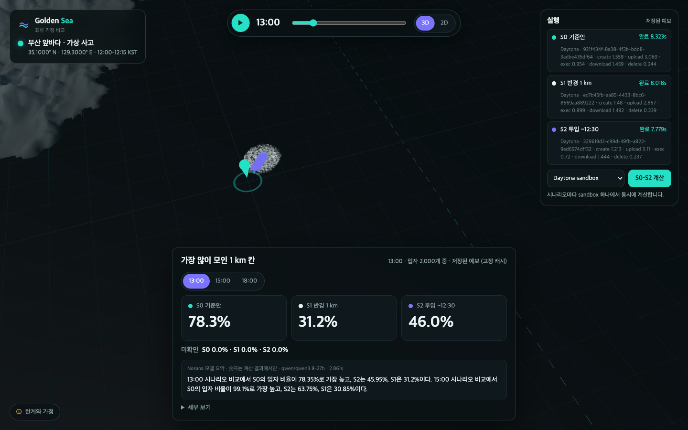

# Golden Sea

**Not one predicted line, but the whole plausible sea.**
When someone falls overboard, Golden Sea runs several "what-if" worlds side by side (same particles, one assumption changed each) and shows where 2,000 drift particles gather over the next six hours.



| | |
| --- | --- |
| Problem | Official drift forecasts are shown as one line. Since 2021, 165 of 256 sea and coastal missing-person cases in Korea are still unresolved (Korea Coast Guard data as reported by Munhwa Ilbo); in one Busan tugboat case the person was found about 100 km away in Pohang (Nocut News). |
| What it does | Synthetic incident off Busan (35.1°N, 129.3°E, 12:00–12:15 KST). S0 baseline (250 m radius), S1 radius 1 km, S2 release until 12:30. 6-hour playback in 3D/2D, the share of particles in the densest 1 km cell at 13:00 / 15:00 / 18:00. |
| Result (stored forecast) | Densest 1 km cell at 13:00: S0 78.4%, S1 31.2%, S2 46.0%. By 18:00 all particles leave the demo domain and are shown as unresolved, not as 0. |
| **Daytona** | Each scenario runs in its own Daytona sandbox: create → upload engine, contracts and cached forecast → run → download result → delete. Measured: 3 sandboxes in parallel, about 8 s each (create 1.2–1.6 s, upload ~3 s, compute ~0.9 s, download ~1.4 s, delete ~0.2 s). |
| **Nosana** | The result is summarised by `qwen/qwen3.8-27b` on Nosana inference (OpenAI-compatible), about 3 s, prompted to reuse computed numbers only and never call particle shares "probabilities". |
| Honesty | Synthetic incident, cached Open-Meteo forecast (SHA-256 pinned), single-point uniform current, coastline and surface-current accuracy unverified. Not official search guidance. |

Built at Daytona HackSprint Seoul, 2026-10-18.

---

## 한국어

바다에 사람이 떨어졌을 때, 하나의 예측선 대신 **가정을 바꾼 여러 세계**를 동시에 돌려 입자가 어디로 퍼지는지 비교합니다.
Daytona HackSprint Seoul · 2026-10-18.

- 사고: 부산 앞바다 **가상** 사고 (35.1°N, 129.3°E), 투입 12:00–12:15 KST, 입자 2,000개, 6시간
- 시나리오: S0 기준안(반경 250 m) · S1 반경 1 km · S2 투입 ~12:30 (같은 초기 표본 공유)
- 입력: 저장된 Open-Meteo 해류·GFS 바람 응답(SHA-256 고정, Git 미포함)
- 화면: 3D/2D 지도, 6시간 재생, 시나리오별 핵심 숫자, 실행 패널(로컬 / Daytona sandbox)
- 공식 수색 안내가 아니며 입자 비율은 발견·생존 확률이 아닙니다. 해안선·표층 유속은 미검증입니다.

## 실행

```bash
# 저장된 예보 2개를 private-inputs/drift-cache-v1/ 에 둔다 (해시 불일치 시 SETUP_BLOCKED)
python3 server.py                 # http://127.0.0.1:8787  (stdlib only)
python3 -m unittest discover -s tests
```

예보 파일이 없으면 화면이 SETUP_BLOCKED를 알리고, UI 개발용 합성 흐름(예보 아님)으로만 보여 줍니다.

## Daytona / Nosana (현장 연결)

- Daytona: `pip install daytona` 후 `DAYTONA_API_KEY`(필요 시 `DAYTONA_API_URL`, `DAYTONA_TARGET`)를 환경 변수로 넣으면 실행 패널에서 "Daytona sandbox"를 고를 수 있습니다. 시나리오마다 sandbox 하나를 만들어 엔진·계약·캐시를 올리고 `python3 -m goldensea.run`을 실행한 뒤 결과를 받고 sandbox를 지웁니다. 단계별 시간(create/upload/exec/download/delete)을 기록합니다.
- Nosana: OpenAI 호환 엔드포인트를 `NOSANA_LLM_URL`(…/v1), `NOSANA_LLM_MODEL`, 필요 시 `NOSANA_API_KEY`로 넣으면 `/api/brief/<batch>`가 계산 숫자만 바꿔 말하는 요약을 만듭니다(새 숫자·확률 표현 금지).
- 로컬 실행은 항상 "로컬 실행 (스폰서 실행 아님)"으로 표시합니다.

## 구조

| 경로 | 내용 |
| --- | --- |
| `goldensea/engine.py` | EQC 투영, 해류(TO)·바람(FROM) 벡터, ≤600초 분할 적분, 상태(ACTIVE/UNRELEASED/DATA_MISSING/OUT_OF_DOMAIN/STRANDED), 원래 N 분모 집계 |
| `goldensea/forcing.py` | 캐시 SHA-256 확인, 요청 index 선택, KST/UTC 정규화, 시간별 구간 |
| `goldensea/run.py` | 시나리오 실행, 10분 프레임, 13/15/18시 평가, 출처·시간 기록 (CLI 겸용) |
| `goldensea/executors.py` | 로컬 / Daytona sandbox 실행 |
| `goldensea/briefing.py` | 선택: Nosana 요약 |
| `server.py`, `web/` | stdlib 서버와 three.js 화면 (three 0.160 로컬 사본 `web/vendor/`, MIT) |
| `contracts/` | 고정 기준(demo-drift-criteria-v1.json, SHA 고정), 초기 입자, 캐시 manifest |
| `tests/test_criteria.py` | 고정 기준 파일에서 기대값을 읽는 테스트 |
| `tools/make_terrain.py` | Copernicus DEM GLO-30 → `web/assets/terrain.png` |

지형: Produced using Copernicus WorldDEM-30 © DLR e.V. 2010-2014 and © Airbus Defence and Space GmbH 2014-2018 provided under COPERNICUS by the European Union and ESA; all rights reserved. 표시용이며 해안선 검증이 아닙니다.
